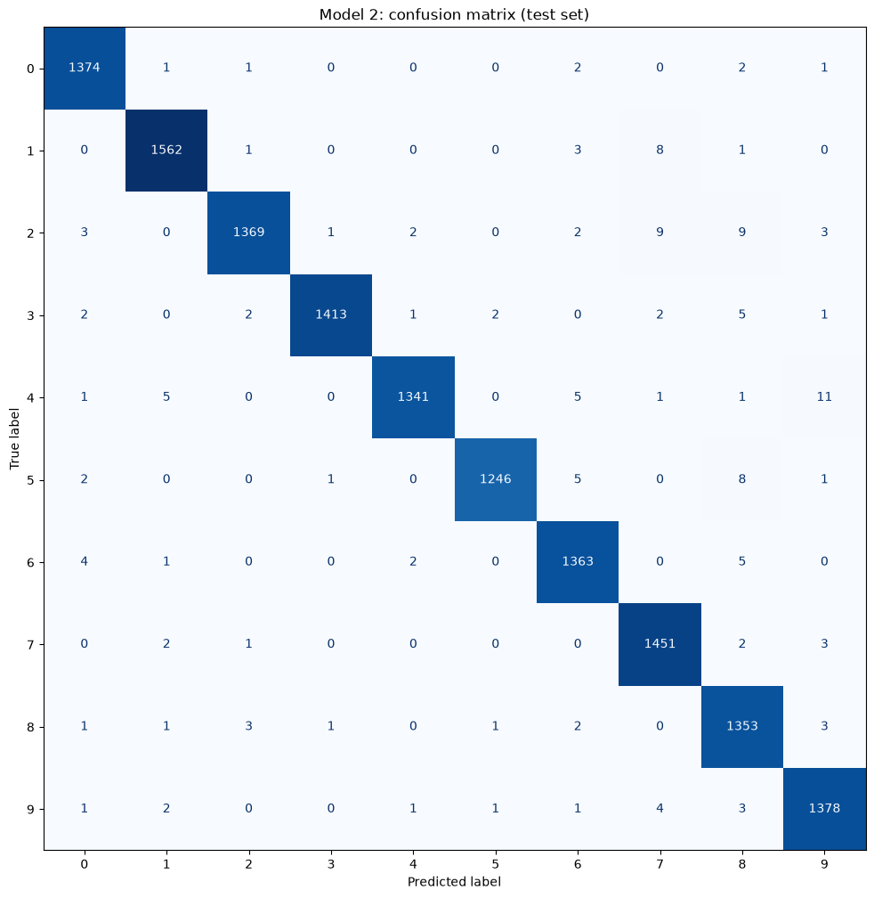
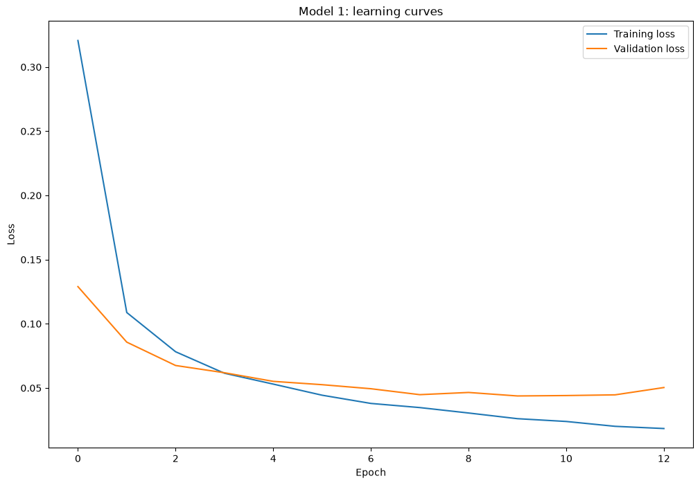

# Where does my CNN make its mistakes? A handwritten-digit classifier on MNIST

I trained a convolutional neural network (CNN) to recognise handwritten digits, then studied *where* it goes wrong with a confusion matrix, and tested whether one change to the network moves those mistakes.

**Files**
- `Final_Project_Option1_CNN_MNIST_completed.ipynb` – the full notebook, all cells run, outputs visible
- `Final_Project_Option1_CNN_MNIST_completed.html` – the same notebook exported as a web page
- `confusion_matrix_model1.png`, `confusion_matrix_model2.png`, `learning_curves_model1.png` – key figures

## 1. Problem statement
Software that reads handwritten numbers (postcodes, account numbers) must be judged not only on how often it is right but on where it goes wrong, because a confident misreading has a real cost. **Central question:** where does the CNN make its mistakes, and does one change to the model move them?

## 2. Data set
MNIST: 70,000 greyscale images of handwritten digits, 28 x 28 pixels, labelled 0 to 9. It is loaded from OpenML inside the notebook (`fetch_openml`). Each input is the pixel brightness values of one digit image, and the target is the digit it shows.

## 3. Method
**Preprocessing**
- Each flat row of 784 values is reshaped into a 28 x 28 x 1 image.
- Pixel values are scaled from 0-255 to 0-1.
- Stratified 80/20 split into 56,000 training and 14,000 test images (`random_state=42`). 10% of the training data is held back for validation during training.

**Model 1 (baseline):** Conv2D(32, 3x3, ReLU) -> MaxPooling(2x2) -> Dropout(0.3) -> Flatten -> Dense(64, ReLU) -> Dense(10, softmax).
Adam optimiser, sparse categorical crossentropy, batch size 128, up to 15 epochs, EarlyStopping on validation loss (patience 3, best weights restored), random seed 42.

**Model 2 (the one change, "deeper network"):** identical to Model 1 except a second Conv2D(64, 3x3, ReLU) + MaxPooling(2x2) block is added before the Flatten layer. Same seed, optimiser, loss and callback, so the comparison is fair.

**Evaluation:** accuracy and loss on the untouched test set, confusion matrices, and the counts for the most frequent confusion pairs before and after the change.

## 4. Results

| | Model 1 | Model 2 (deeper) |
|---|---|---|
| Test accuracy | 98.69% | 98.93% |
| Test loss | 0.0463 | 0.0351 |
| Errors (of 14,000 test images) | 183 | 150 |
| 4 predicted as 9 | 13 | 11 |
| 2 predicted as 7 | 12 | 9 |

Errors by true digit (Model 1 / Model 2): 0: 7/7, 1: 15/13, 2: 35/29, 3: 19/15, 4: 22/24, 5: 15/17, 6: 13/12, 7: 9/8, 8: 25/12, 9: 23/13.

**Model 1 confusion matrix**

**Model 2 confusion matrix**

**Learning curves (Model 1)**

## 5. Interpretation
- The most frequent mistakes involve digits with overlapping shapes: 4 read as 9 (13 images) and 2 read as 7 (12 images), followed by 9 as 7, 2 as 8 and 1 as 7 (8 each). A 4 with a closed top looks like a 9, while a 2 with a straight diagonal and no curl can look like a 7.
- The deeper network raised accuracy by 0.24 points (33 fewer errors). Both tracked pairs went down, but only slightly. The clearer movement was elsewhere: errors on 8 and 9 roughly halved, while 4 and 5 got slightly worse.
- **Limitations:** each model was trained once, with one seed and one split. A gain of about a quarter of a percentage point is small, so this is evidence of a modest improvement, not proof that the deeper network is better.
- **Ethics:** MNIST was written by a limited group of writers (US Census Bureau staff and high-school students). Handwriting from other countries or schools may be read less reliably, and a confident wrong reading could send a letter to the wrong place or a payment to the wrong account. A real pipeline would need a confidence threshold, human review of uncertain or high-value cases, and testing on the handwriting of the people it serves.

## 6. Reflection
- **What worked:** a small CNN reached about 98.7% quickly, EarlyStopping limited overfitting, and the confusion matrix made it easy to see which digits get mixed up. Changing only one thing made the comparison clear.
- **What was difficult:** judging whether a small gain is real or just training randomness, and getting the TensorFlow/Keras packages installed and compatible.
- **With more time I would:** repeat training with several seeds and average the results, try data augmentation (shifts, rotations) to cover more handwriting styles, look at the actual misclassified images, and test a confidence threshold for sending uncertain readings to a person.
